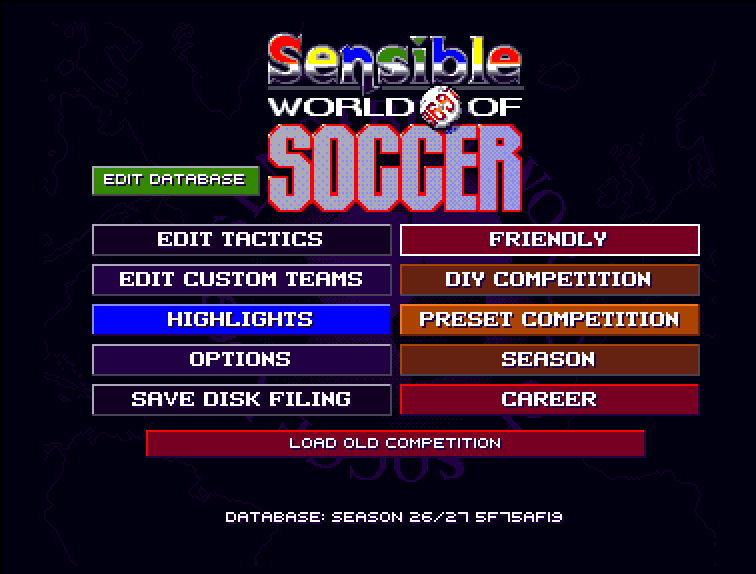
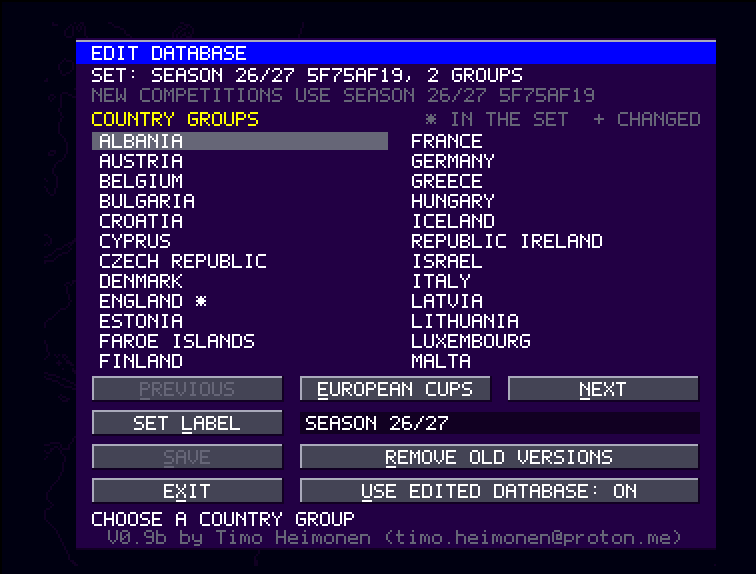
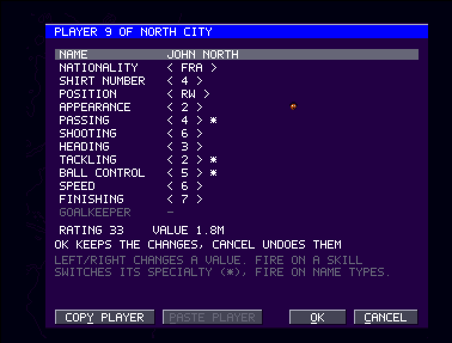

# SWOS 96-97 In-Game Editors

In-game editors for the Amiga game **Sensible World of Soccer '96-'97**, as a
WHDLoad install for a hard disk. You edit your custom teams and players,
tactics, tournament definitions and the game's own database of clubs and
national teams on the game's own screens, play with them at once, and move
everything a tournament needs between machines and a computer: teams and
players as CSV, season updates as small packs, tournament definitions, and
the results of every match played on every machine.

`patch.py` makes the install from your own copy of the game: your images of
its two disks, which it identifies by their SHA-256. This repository holds
only the editors' and the slave's own code and the tools; it contains no
game files and no part of the game's code.

## Screenshots







More: [a custom team](docs/screenshots/custom-team.png),
[the team page](docs/screenshots/team-page.png),
[team settings with the strength line](docs/screenshots/settings.png),
[a country's clubs](docs/screenshots/group.png),
[the European cups](docs/screenshots/cups.png),
[a tournament's rules](docs/screenshots/rules.png),
[the definitions](docs/screenshots/load-definition.png),
[a tactic](docs/screenshots/tactic.png) and
[a tactic check](docs/screenshots/tactic-check.png).

## Requirements

- An Amiga 1200 compatible machine (68020, AGA) with Kickstart 3.1, WHDLoad
  17 or later, 2 MiB of chip memory and 2 MiB of fast memory. Tested on an
  emulated A1200 (68020, AGA, Kickstart 3.1, 2 MiB chip and 4 MiB fast
  memory); not tested on real hardware.
- Python 3.9 or later (for `patch.py`); only its standard library.
- [vasm](http://sun.hasenbraten.de/vasm/) `vasmm68k_mot` and
  [vlink](http://sun.hasenbraten.de/vlink/) (only for `build.py`).
- ADF images of the game's two disks with these SHA-256 hashes (the names
  are the ones these images are commonly catalogued under):

| Disk | Image | SHA-256 |
| --- | --- | --- |
| 1 | `Sensible World of Soccer '96-'97 (1996)(Renegade)(Disk 1 of 2)[cr HF][a2].adf` | `b70c0db66d8c2e93f1e12aa00c5df4b465c9f29d458723130e5a946428ca92ee` |
| 2 | `Sensible World of Soccer '96-'97 (1996)(Renegade)(Disk 2 of 2)[cr HF].adf` | `ed921246c05531a2445a3f61aee4afd493771ab79042d7c4ed210fd3f3c30d36` |

Other images are refused.

## Making the install

```sh
python3 patch.py install "Disk 1.adf" "Disk 2.adf" --output SWOS --machine "TABLE 1"
```

The images can be given in any order. `patch.py` checks both images before
it writes anything, only reads them, and reads every file back after writing
it. It creates the new directory `SWOS`:

| Path | Contents |
| --- | --- |
| `SWOS.slave` | The WHDLoad slave |
| `SWOS.info` | The Workbench icon, with the tool types `PRELOAD NOWRITECACHE WRITEDELAY=10` |
| `Editor.bin` | The editors |
| `Disk.1`, `Disk.2` | Your disk images; the game only reads them |
| `data/` | The save directory: the game's saves, the editors' files and the match log |

`--machine` names the install in the match log; `--set` installs an edited
database (a season pack, CSV files or group JSON files) that is in use from
the first start. Copy the directory to your hard disk and start the game from
its icon, or from the shell:

```text
WHDLoad SWOS.slave PRELOAD NOWRITECACHE WRITEDELAY=10
```

**F10** quits WHDLoad. If the main menu has no EDIT DATABASE, the editors did
not load (for example `Editor.bin` is missing) and the original game runs.

## Using the editors

The [user manual](docs/manual.md) describes it all. In short:

- **EDIT CUSTOM TEAMS** gains a player screen (name, nationality, position,
  appearance, skills and specialties, a goalkeeper's rating, copy and paste
  of players), team settings (default tactic, lineup, shirt numbers, a
  strength summary) and checks before a team is accepted. `CUSTOMS.EDT` is
  saved with a verified backup first.
- **EDIT TACTICS** checks every tactic before it is used and loads and saves
  `.TAC` files exactly; tactics you loaded stay in their slots when a new
  competition starts.
- **DIY COMPETITION** gains RULES (every rule, and whether the game can run
  the setup), SAVE DEFINITION and LOAD DEFINITION: tournament definitions
  with their teams and tactics, to start the same competition again or on
  another machine.
- **EDIT DATABASE** edits the clubs and national teams of the game's
  database for new competitions, seasons and careers, with DIVISION SWAP,
  EXCHANGE and COPY TO COUNTRY, a set label and a fingerprint every machine
  shows. The European club cups and the foreign player market follow the
  edited database. A competition stays bound to the database it started
  with.
- **The match log**: every match the game plays is added to
  `data/MATCHES.LOG` with the score and the scorers.

## patch.py

| Command | |
| --- | --- |
| `install` | A new install, optionally with an edited database in use |
| `list` | What an install's save directory holds, with every fingerprint |
| `check` | Checks files as the game and the editors do |
| `export`, `import` | The custom set, tactics and definitions as JSON and CSV |
| `db export`, `db import`, `db diff`, `db apply`, `db check`, `db switch` | The database as JSON and CSV, season packs of changed fields |
| `report` | Standings, cup results and scorers of competition saves |
| `results` | The match logs of several machines as one table |
| `machine` | Renames an install for the match log |

The manual's chapter [Season update and tournament day](docs/manual.md#10-season-update-and-tournament-day)
goes through a season of a tournament group with the commands, using the
example files in [docs/examples](docs/examples). Every input is checked
before anything is written, files are read back, and nothing is ever
deleted. Do not run the data commands on an install the game is running
from.

## Build

```sh
python3 build.py "Disk 1.adf"
```

Assembles and links the slave and the editors and embeds them in the
generated section of `patch.py`, so that users of `patch.py` need only
Python. The build reads your disk 1 to check every place where the editors
change the game (by the length and a checksum of the bytes expected there)
and the game's menus the editors extend; no byte of the game enters the
built files.

## How it works

- `whdload/` is the WHDLoad slave. It reads the game's executable from
  `Disk.1`, relocates it as the game's loader does, replaces the game's
  floppy access with file access (game files from `Disk.1` and `Disk.2`,
  the save disk is the directory `data/`), loads `Editor.bin` into WHDLoad's
  expansion memory, checks it and installs its hooks, all or nothing.
- `src/editor/` is the editors: they extend the game's own menu screens and
  add screens of their own drawn on the game's menu screen, and work on the
  game's own data structures; every write goes through the slave, is read
  back and never deletes a file.
- `tools/` holds the codecs `patch.py` uses: teams and players, tactics,
  tournament definitions, competition saves, the edited database with CSV
  and season packs, the match log and the disk images.

The [architecture](docs/architecture.md) describes the slave, the editors
and their files; the [file formats](docs/file-formats.md) describe the JSON
and CSV files of `patch.py`.

## Docs

- The [user manual](docs/manual.md).
- The [architecture](docs/architecture.md).
- The [file formats](docs/file-formats.md): the JSON and CSV files of `patch.py`.
- The slave's own [README](whdload/README.md).
- The changes by version are in [CHANGELOG.md](CHANGELOG.md).

## Author

Timo Heimonen <timo.heimonen@proton.me>

## Legal

Sensible World of Soccer is the property of its original rights holders
(Sensible Software / Renegade). This project is not affiliated with them.
The repository contains no game files and no part of the game's code; you
need your own copy of the game. The project's own code is released under the
[MIT License](LICENSE), which covers only this project's code, not the game.
